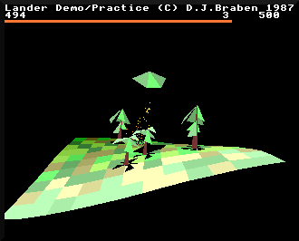

# micropython-lander

MicroPython port of [Lander](https://lander.bbcelite.com/),
David Braben's epic game for the Acorn Archimedes.



## Development

```sh
git clone https://github.com/gbenson/micropython-lander.git
cd micropython-lander
python3 -m venv .venv
. .venv/bin/activate
pip install --upgrade pip
pip install -e .
```
